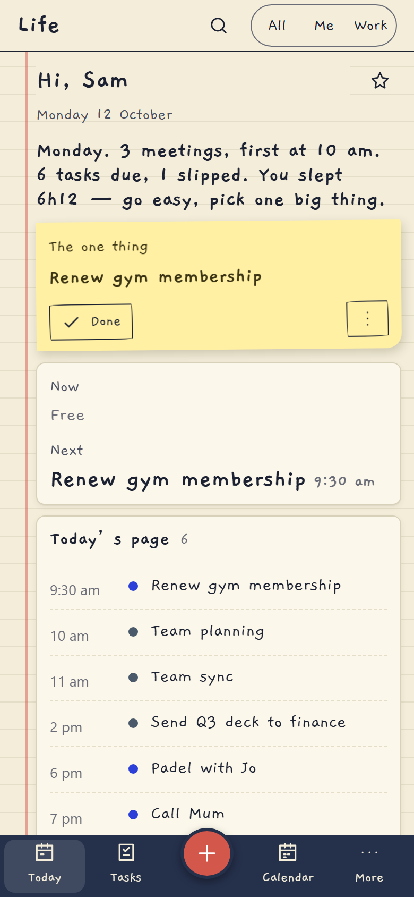
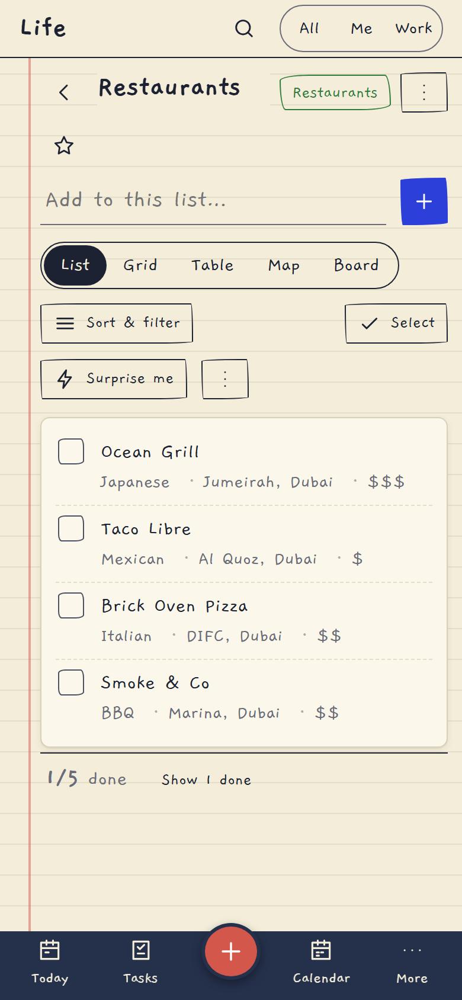
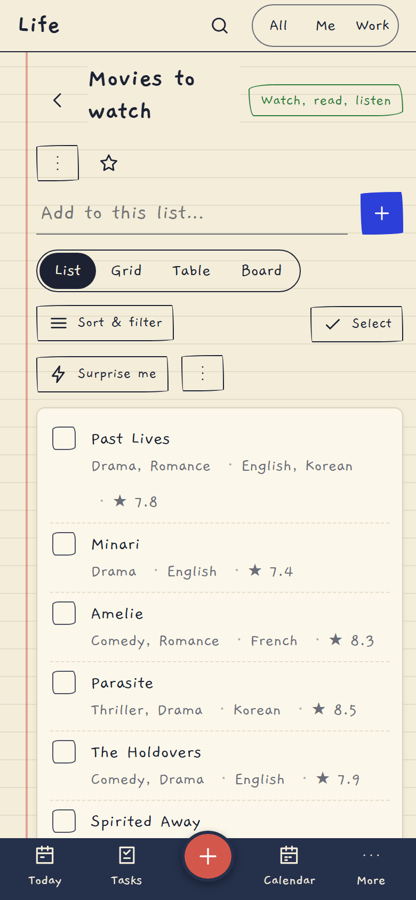
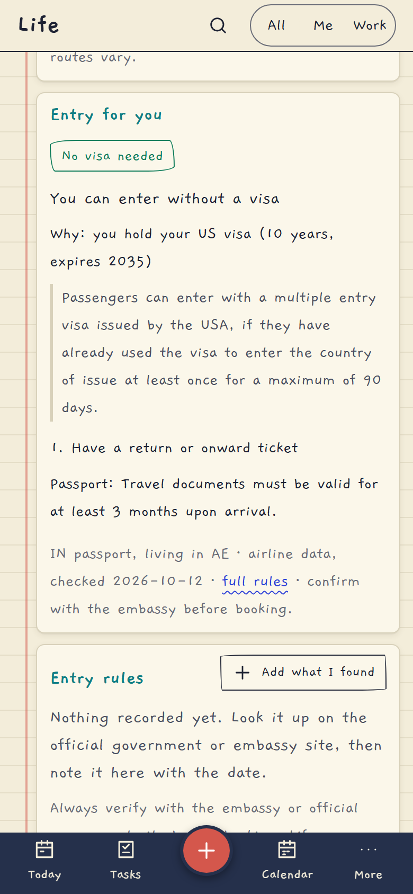

# Life: your day, quietly

A private, single-user life manager that looks and feels like a notebook: ruled paper, a red margin line, handwritten type (Gaegu, self-hosted). One place for *today*, *what's on my mind*, *what to eat and watch*, *where I'm going*, *how I'm doing* and *work to-dos from a locked-down PC*. **It runs on your own computer and is built to live on your iPhone.**

<p align="center">
   
</p>

**Docs site (GitHub Pages):** the `docs/` folder is a small static site with screenshots, an iPhone guide, setup and security notes. Enable it under *Settings → Pages → Deploy from a branch → `main` / `/docs`*.

## Highlights
* **Share anything into your lists.** Instagram posts (caption *and every slide*), web pages and screenshots are read, filed into the right list (Restaurants, Cafes, Movies, Series…), **de-duplicated**, and filled in: cuisine, area, cost; genre, language, year, ★ IMDb. Rows stay short; details are one tap away.
* **Travel that knows you.** "Entry for you" on every country page from your passport, residence and the **visas you hold** (with the reason and the airline's own condition), a "Where can I go?" explorer, daily alerts when rules change for countries you plan to visit, and a smarter pre-trip checklist.
* **iPhone first.** Install to the Home Screen, **Face ID** unlock, push **notifications**, swipe rows, pull to refresh, drag-down sheets, a Share Sheet Shortcut, an **iPhone Calendar feed**, a Siri "what's my day?", launch screens.
* **Private.** Runs locally, one SQLite file, keys stored encrypted, no analytics or trackers. See [SECURITY](SECURITY.md) and [PRIVACY](PRIVACY.md).

Flask + SQLite (WAL) + vanilla JS. Installable PWA, offline-first (IndexedDB + outbox), no framework, no analytics, no third-party requests (fonts, maps' world shapes, charts and QR code libraries are all vendored).

## Run it (Windows)

```bat
run.bat
```
First run creates `.venv`, installs `requirements.txt`, and starts the server on <http://127.0.0.1:5055>. Open it and choose a password (8+ characters). `run.sh` does the same on Mac/Linux.

Optional integrations (Telegram, Anthropic/OpenAI, Gmail, Garmin, OMDb) are entered in **Settings** (stored encrypted, applied instantly); `.env` still works as a fallback. Everything works without any of them; each integration fails soft into **Settings → Data health**.

Run it as a background Windows service the way you do the wealth app (NSSM): program `…\.venv\Scripts\python.exe`, arguments `app.py`, start directory = this folder.

Reach it from your phone: **[SETUP-PHONE.md](SETUP-PHONE.md)** (Tailscale + HTTPS, or a VPS).

## What's in it

| Page | What it does |
|---|---|
| **Today** | One calm sentence + "the one thing" sticky note, now/next, today's page, due & slipped (never a wall of red), mood check-in, habits, body strip, "what should I do?", trip countdown, on-this-day, evening shutdown mode |
| **Inbox** | Capture anything in <3 s (`C`, or the red button). Natural-language chips (`tomorrow 3pm`, `every monday`, `#tag @ctx !high +Project`), URL → link note, dictation, share-target. Triage one card at a time |
| **Tasks** | Today / Upcoming / Anytime / Someday / Projects(+board) / Contexts / Done; recurrence incl. "after completion"; reminders (push, Telegram, in-app, snooze, critical re-nag); Work ⟷ Personal mode filters everything |
| **Calendar** | Day/week/month/agenda; ICS feeds (read-only, no OAuth); native events; drag a task onto the grid to time-block |
| **Notes** | Markdown, backlinks `[[like this]]`, daily note, templates, FTS5 search, 20 versions, attachments, "Assist" (summarise, extract tasks, clean up…) with approval |
| **Lists** | Restaurants, places to play, things to do/eat, media, gifts, wishlist, grocery, packing, read-later + your own types; list/grid/table/board/**map**; "surprise me"; share as Markdown or expiring link |
| **Goals** | Goals with a required *why* (max 3 big), live links to wealth/Garmin numbers with pace, habits with forgiving streaks + heatmaps, life wheel, wins, vision & values, notes to future you, **What should I do?** |
| **Travel** | Scratch-style world map, country "passport" pages, trips (itinerary, bookings, offline documents, packing, budget in any currency, pre-trip checklist, journal, recap), visa notes you record and date, Schengen 90/180 calculator, documents vault (encrypted numbers), expiry radar, leave & bridge days, "where can I go?" |
| **Health** | Garmin summaries (or CSV/TCX/FIT import), trends, mood & energy, quick logs, plain-sentence patterns (with sample sizes), appointments / vaccines / prescriptions / blood-test trends |
| **Assistant** | Claude via a server-side proxy. Reads your data (per-module toggles; health off by default), acts only through **confirm cards**, everything logged and undoable, visible memory, "preview exactly what's sent", monthly cost cap |
| **Review** | Weekly (auto-assembled, saved as a note), monthly, and the **year in review** poster (print to PDF) |
| **More** | People, Life admin (maintenance, warranties, subscriptions, decisions, someday, yearly checklist, **emergency card** encrypted with your PIN, review cards, meals), Work capture |

### Notion-style building blocks
Favourites & saved views (☆ on any page or filtered task view; they appear in the sidebar with your recently opened pages) · **Trash** with restore (and delete-forever) · **Duplicate** tasks, notes, list items, lists and trips · **Relations**: link any item to any other, with backlinks · page **icons & covers** · rich notes with **toggles, callouts, dividers** · custom list fields with **formulas** (`price * qty`, `daysSince(date)`, `if(...)`) and a summary bar (totals, averages, % done) · **group by** (lists and tasks) with collapsible groups · **CSV** import/export for lists and tasks, Markdown-file import for notes · **buttons** (one-tap task templates) and **automations** (when a task is done / a list item's status changes / on a schedule → create a task or note, add a win, stamp a date) · habit rollups (days since last, this month, 30-day rate) · “remind me near a place” (works while Life is open: browsers can't geofence in the background).

Keyboard: `C` capture · `T` task · `N` note · `/` or `Ctrl+K` palette · `Ctrl+J` assistant sheet · `G` then `D/T/N/L/C/I/G/H/V/R/S` go-to · `J/K` move, `X` done, `E` edit, `1–4` priority · `?` list.

## Your data

* One SQLite file: `data/life.db`. **Settings → Your data → Export everything** gives a zip (JSON + Markdown notes); **Import** restores it. Encrypted fields stay encrypted in exports.
* Nightly backup to `data/backups/life-YYYYMMDD.db`, 14 days kept.
* **Back up `data/fernet.key` too** (it encrypts passport/ID numbers, health values, file scans). Lose it and those fields are unrecoverable by design.
* Restore a backup: stop the server, copy the chosen `life-….db` over `data/life.db`, start again.
* "Load demo data" (Settings) is explicit and removable in one click. No fake data anywhere else.

## Tests (run before trusting a change)

```bat
.venv\Scripts\python tests
un_all.py          :: everything (about 6 minutes)
.venv\Scripts\python tests
un_all.py --fast   :: syntax + unit + backend only (about 30 s)
```
Covers: natural-language dates, recurrence, Schengen 90/180, sync conflicts, encryption, a security checklist (auth + CSRF on every route, XSS, SSRF, uploads, rate limits, no secrets in errors, **no key-shaped strings anywhere in the repo**), reminders and notifications (categories, quiet hours), Telegram, Garmin sign-in (one password sign-in, then tokens only), the share pipeline (mock model), entry rules and the all-countries explorer, **Face ID** (a fake authenticator tries wrong origin, wrong app, replay…; and a real browser with a virtual authenticator), touch gestures with real touch events, a Playwright pass over every page at desktop and phone size in both themes, axe-core WCAG AA, offline mode, and speed on a 2,500-task data set.

## Honest status: what has and hasn't been exercised live

Verified by automated tests against real code paths: everything above.
**Exercised live during development** (with a real key, on sample posts): the Instagram share pipeline, enrichment (Wikidata, OpenStreetMap), and the entry-rule lookup with the OpenAI Decisions API. **Not exercised against a real device or account** (needs hardware or credentials): Face ID on an actual iPhone (tested with a virtual authenticator), iOS push delivery, the iOS Shortcut and Calendar subscription, Garmin login/MFA/sync (`garminconnect` is unofficial and may break — file import is the fallback), Gmail IMAP, Telegram delivery, the wealth-app endpoints (contract in [WEALTH-API.md](WEALTH-API.md)). Each has exact verification steps in its setup doc and a status line in Settings → Data health.

Docs: [ROADMAP](ROADMAP.md) · [SETUP-PHONE](SETUP-PHONE.md) · [SETUP-WORK-PC](SETUP-WORK-PC.md) · [SETUP-GARMIN](SETUP-GARMIN.md) · [SETUP-TELEGRAM](SETUP-TELEGRAM.md) · [PRIVACY](PRIVACY.md) · [SECURITY](SECURITY.md) · [WEALTH-API](WEALTH-API.md) · [DESIGN](DESIGN.md) · component gallery at `/_styleguide`.
